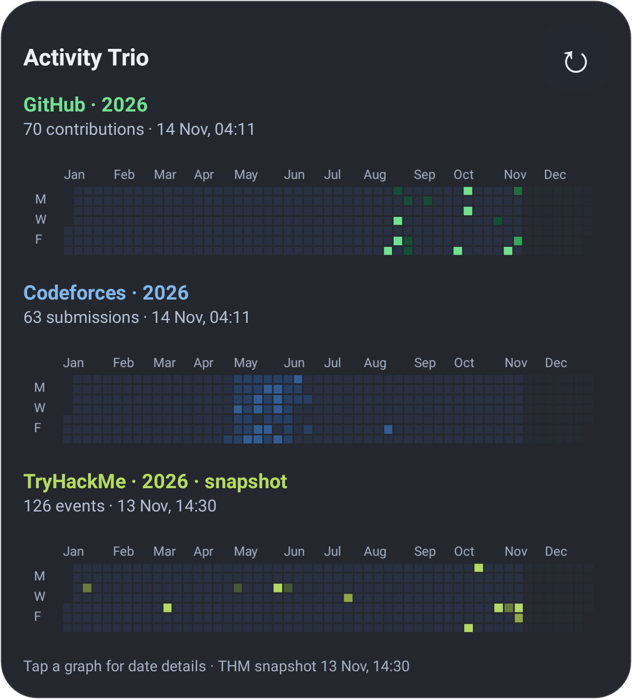

# Activity Trio

**GitHub, Codeforces and TryHackMe activity — together on your Android home screen.**

A lightweight native Java Android app with a combined 3-in-1 widget and three
individual widgets. Resizable, offline-capable and ad-free. Android 8.0+;
target API 35. No WebView, Google account connection, GitHub token or analytics.

[Download the APK](https://github.com/0xSaadBinSultan/activity-trio/releases/latest)
 · [Report an issue](https://github.com/0xSaadBinSultan/activity-trio/issues)
 · [MIT license](LICENSE)



The screenshot shows real public profile data captured in November 2026.
**TryHackMe is a dated, manually updated snapshot, not a live API feed.**

## Install

1. Download `ActivityTrio-v1.0.0.apk` from Releases and open it on your Android phone.
   Allow installation from that browser/file manager if Android asks.
2. Open **Activity Trio** once. Use **Profiles** to set your public usernames,
   timezone and year. The initial profiles are the author's public profiles;
   no login is required. The initial timezone is `America/New_York`; change it
   to your preferred IANA timezone when needed. Year `0` follows the current year.
3. Tap **Add widget → All three together**. If your launcher does not support
   pinning, long-press Home → Widgets → Activity Trio and drag a widget onto Home.
4. Long-press the widget to resize it. Cells stay square. Tap a graph to open
   date details; tap a cell, pinch to zoom, or use **Choose date** for precision.

## Refresh behavior

GitHub and Codeforces refresh roughly every six hours while a widget is present.
Android and your launcher's battery restrictions can delay background work.
The refresh button requests an update, with cooldowns after requests and rate
limits. Failed requests preserve the last successful cache and its timestamp.
Removing every widget stops the periodic job. Opening the app requests a refresh
if its previous request was more than an hour ago. The app works offline from cache.

A home-screen image widget cannot provide desktop hover tooltips; tapping opens
the native interactive graph. TryHackMe updates through **Import snapshot** only.

## What the graphs mean

- **GitHub:** public contribution calendar and counts from GitHub’s public profile. Contribution dates follow GitHub. No private repository access is requested.
- **Codeforces:** all submission attempts, including wrong answers and compilation errors, grouped by the selected timezone. These are not counts of distinct solved problems. Public `user.status` is paginated, with at least 2.2 seconds between page requests. An oversized or failed history never replaces the cache with a partial total.
- **TryHackMe:** explicitly a **dated public-profile snapshot**, initially captured on 13 November 2026. Automated requests were blocked/rate-limited, so the APK does not retry that endpoint, sign in or obtain cookies. Exact daily counts are unavailable: tapping a date shows its activity level, and the total is the profile’s reported total. It never labels the snapshot live.

The bundled GitHub/Codeforces seeds are real dated public caches, not sample activity. Their timestamps remain visible until a successful refresh. A changed profile/year cannot display another profile’s old live cache. The TryHackMe snapshot retains its actual year, regardless of the selected live-feed year.

### Update TryHackMe

Use the laptop TryHackMe activity widget’s **Export instructions** to export a new public-profile JSON snapshot. Transfer that JSON to the phone, then **Import snapshot** in Activity Trio. The app validates the provider, username, year, full-year color list, capture timestamp and reported total, and keeps the previous snapshot if validation fails. File access is limited to the document you select. See `tryhackme-export.html` and `tryhackme-export.js` alongside this README for the desktop instructions/helper. The helper reads the visible public graph, not cookies or hidden APIs.

## Privacy

There are no GitHub/Google API tokens or OAuth clients in this project or APK. Only the configured public usernames are sent, over HTTPS, to GitHub/Codeforces. Your device necessarily exposes its IP address to those services. Browser profile links open your normal browser. Cached public activity and settings stay in the app’s private storage; Android app backup is disabled. The user-selected TryHackMe import is local. No personal Google Calendar, Tasks, notes or Drive connection is used.

## Build

Use JDK 21, Gradle 8.9 (the wrapper pins its official distribution SHA-256), Android Gradle Plugin 8.7.3, Platform 35 and Build Tools 35.0.0. Install SDK packages through Google’s official SDK Manager after reviewing the SDK license:

```sh
chmod +x gradlew build-release.sh
sdkmanager 'platforms;android-35' 'build-tools;35.0.0' 'platform-tools'
printf 'sdk.dir=%s\n' "$ANDROID_HOME" > local.properties
JAVA_HOME=/path/to/jdk-21 ./gradlew --no-daemon testDebugUnitTest lintRelease assembleRelease
```

Tests cover real snapshot parsing, invalid imports, GitHub counts, timezone/year boundaries, duplicate submissions, cache isolation, calendar hit-testing, RemoteViews layouts/resizing, refresh throttling and app rendering on APIs 28 and 35. The API 35 render test writes `app/build/reports/screenshots/dashboard.png`. Optional live-response parser checks run when `ACTIVITY_TRIO_LIVE_FIXTURES` points to a local folder containing freshly downloaded public `github.html` and `codeforces.json` responses. No credentials are required. These host-side tests do not replace checking the final app on a physical phone/launcher.

To sign your release, use your own private key; do not add it to Git or paste its password into a terminal command. `build-release.sh` uses a private keystore directory under your home folder, generates its password into a mode-600 local file, and reads passwords from files. Back up that directory securely outside Git if you want to sign compatible future updates. Source recovery alone cannot recover the signing identity. A differently signed build requires uninstalling the previous app first, which removes its local settings.

```sh
JAVA_HOME=/path/to/jdk-21 ANDROID_HOME=/path/to/android-sdk ./build-release.sh
```

Build artifacts, SDK paths, Gradle caches and signing files are excluded from Git. Signing keys and passwords belong outside the repository. The public release APK is signed by the maintainer; your fork should use your own signing identity.

Official references: [Android widgets](https://developer.android.com/develop/ui/views/appwidgets/overview), [SDK Manager](https://developer.android.com/tools/sdkmanager), [Codeforces API](https://codeforces.com/apiHelp/methods).

## License and contributions

Original app code: **MIT**, copyright 2026 0xSaadBinSultan. See [LICENSE](LICENSE),
[NOTICE](NOTICE) and [CONTRIBUTING.md](CONTRIBUTING.md). Gradle and other upstream
components retain their own licenses.
